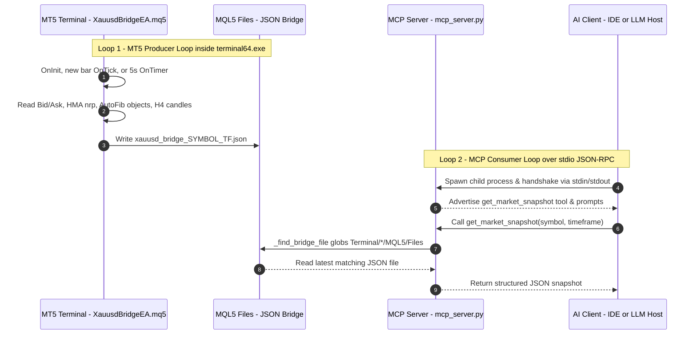

# XAU/USD (Gold) Analysis MCP + MQL5 Bridge + Skill

Combines live MetaTrader 5 spot & three custom MQL5 indicators ([`HMA nrp.mq5`](../../indicators/HMA%20nrp.mq5), [`AutoFibAutoTrend.mq5`](../../indicators/AutoFibAutoTrend.mq5), and [`CustomCandle.mq5`](../../indicators/CustomCandle.mq5) via `code/XauusdBridgeEA.mq5` + `code/mcp_server.py`) with an agent skill ([`SKILL.md`](SKILL.md)) to produce structured, actionable Gold (`XAU/USD`) market reports.

---

## What the Skill Does ([`SKILL.md`](SKILL.md))

1. **Reads Live MT5 Spot & All 3 Indicators (via MCP `get_market_snapshot`):**
   - **`HMA nrp` (Period 21):** Current/previous HMA values, trend direction (`+1.0` / `-1.0`), `candles_in_trend`, and the exact **`flip_candle`** (`bars_ago`, `time`, `hma_value`, OHLC).
   - **`AutoFibAutoTrend`:** Active swing anchors (`0.0%` → `100.0%`), Fib levels (`0.0%`, `23.6%`, `38.2%`, `50.0%`, `61.8%`, `78.6%`, `100.0%`, `161.8%`), and `channel_present` breakout state.
   - **`H4 CustomCandle`:** Last completed 4-hour candle (`last_h4` OHLC & **last 4hr close**), current 4-hour candle (`current_h4` OHLC), and liquidity-sweep reversal flags (`took_prev_low`, `going_up`, `bullish_sweep_reversal`, `took_prev_high`, `going_down`, `bearish_sweep_reversal`).
2. **Researches Macro, Pivots, Options & Sentiment (via Web Search):**
   - `50D`/`100D` moving averages, classic daily `S1–S3`/`R1–R3` pivots, and Dominion Markets' decision band.
   - Fed rate expectations (CME FedWatch), US 10-year Treasury yields, `DXY`, and upcoming GDP/PCE/CPI/ECI/PMI/NFP catalysts.
   - COMEX Gold (`GC`/`OG`) options expiries, call/put walls, and gamma pin/magnet levels.
   - Retail positioning (IG / Myfxbook) and global gold ETF flows.
3. **Generates a Structured Report (saved under `reports/`):**
   - **Top-of-Report BUY vs. SELL Probability:** Separate Intraday (`M15`–`H1`) and Swing (`H4`–`D1`) conviction percentages.
   - **Levels Gold Can Reach Table & Breakdown:** Maps `AutoFibAutoTrend` channel breakout targets (`38.2%` → **`61.8%`** initial resistance → **`100.0%`** → **`161.8%`**) and downside targets (`HMA nrp` → `0.0%` / `last_h4` low), with a clear driver breakdown explaining why each probability weight is assigned.
   - **Multi-Timeframe Confluence & Scenarios:** Connects `M15` `HMA` flips and `H4` sweep structure to daily MAs, macro headwinds/tailwinds, and concrete Bullish, Bearish, and Invalidation triggers.

---

## How the MCP Flow Works

`code/mcp_server.py` and `code/XauusdBridgeEA.mq5` operate as **two decoupled loops** connected through a shared JSON file on disk—there is no direct network socket or IPC command sent from Python into the EA.



### 1. Producer Loop (`XauusdBridgeEA.mq5` inside MT5)
* When you attach `XauusdBridgeEA` to a chart (e.g., `XAUUSD.p` `M15`), MT5 loads the EA inside `terminal64.exe`.
* On `OnInit()`, every new bar (`OnTick()`), and every `InpTimerSeconds` seconds (`OnTimer()`, default `5`), `ExportSnapshot()` reads:
  * Live `bid` / `ask` via `SymbolInfoDouble`
  * `HMA nrp` buffers and flip candle via `iCustom` + `CopyBuffer`
  * `AutoFibAutoTrend` chart object levels via `ObjectGetDouble`
  * `H4` candles and sweep flags via `CopyRates(..., PERIOD_H4, ...)`
* It writes the payload to `%APPDATA%\MetaQuotes\Terminal\<TerminalID>\MQL5\Files\xauusd_bridge_<SYMBOL>_<TF>.json`.

### 2. Consumer Loop (`code/mcp_server.py` ↔ AI Client)
* When the AI client starts or invokes a tool, it launches `code/mcp_server.py` (`MCPServer("xauusd-analysis-mcp")`) over **`stdio`** (JSON-RPC over `stdin`/`stdout`).
* When the AI calls `get_market_snapshot(symbol, timeframe)` (or its alias `get_xauusd_snapshot`), `_find_bridge_file()` globs `%APPDATA%\MetaQuotes\Terminal\*\MQL5\Files\xauusd_bridge_<SYMBOL>_<TF>.json`, picks the most recently modified file, parses the JSON (up to 1 MiB), and returns `{"ok": True, "file": ..., "data": ...}` to the AI.

### 3. Do You Need a Server Running?
* **No manual daemon or HTTP/socket server is needed** for normal MCP client usage (Claude Desktop, Cursor, Antigravity, etc.):
  * **Between MT5 and Python:** No HTTP/ZeroMQ server is required because `XauusdBridgeEA.mq5` writes directly to `MQL5\Files\` on disk and `mcp_server.py` reads that file on demand.
  * **Between the AI client and `mcp_server.py`:** `mcp.run()` defaults to **`stdio` transport**—the AI client automatically spawns `python code/mcp_server.py` as a background child process when needed and communicates over `stdin`/`stdout`. You only run `mcp_server.py` manually if you switch it to an HTTP/SSE transport or test it directly.
  * **What *does* need to be running:** Your **MetaTrader 5 desktop terminal** with `XauusdBridgeEA` attached to the target chart so the JSON snapshot stays fresh.

### 4. How Does MetaTrader (MT5, not MT4) Know What to Run?
> **Note:** This repository targets **MetaTrader 5 (MT5 / MQL5)** only—not **MT4** (MT4 uses MQL4, `MQL4\Files\`, and does not support the `MetaTrader5` Python IPC package).

* **In `xauusd-analysis` (`code/mcp_server.py`):** Python never sends instructions to MT5 at all. MT5 knows what to run because **you manually attach `XauusdBridgeEA` to a chart** (for example `XAUUSD.p` `M15`). MT5's built-in event loop (`OnInit`, `OnTick`, `OnTimer`) executes the EA continuously on that chart's `_Symbol` and `_Period`, while `mcp_server.py` is strictly read-only on the exported JSON file.
* **By contrast, in `mt5/ai-agent/mcp/mcp_server.py` (General MT5 MCP Server):** If you want Python/MCP tools to dynamically request arbitrary symbols, historical bars, or trades from MetaTrader without pre-attaching an EA to each chart, that server uses the official `MetaTrader5` Python package over **Windows local IPC** to talk directly to the running `terminal64.exe` process.

---

## Files

```text
mt5/ai-agent/xauusd-analysis/
├── SKILL.md                  # Agent skill workflow & report structure
├── README.md
├── reports/                  # Generated XAU/USD analysis reports
│   └── 2026-11-15_xauusd_report.md
└── code/
    ├── XauusdBridgeEA.mq5    # MQL5 EA exporting HMA nrp (with flip candle), AutoFibAutoTrend & H4 CustomCandle
    ├── mcp_server.py         # Standalone MCP server exposing get_xauusd_snapshot & prompt
    ├── requirements.txt
    └── tests/
        └── test_xauusd_mcp.py
```

---

## Setup & Usage

1. **Install dependencies** (from repo root, using the shared `.venv`):
   ```powershell
   .\.venv\Scripts\python.exe -m pip install -r mt5\ai-agent\xauusd-analysis\code\requirements.txt
   ```
2. **Deploy `code/XauusdBridgeEA.mq5` in MT5:**
   - Ensure `HMA nrp.ex5` and `AutoFibAutoTrend.ex5` are in `MQL5\Indicators\`.
   - Copy `code/XauusdBridgeEA.mq5` (or compiled `XauusdBridgeEA.ex5`) to `MQL5\Experts\` and attach it to your `XAUUSD.p` chart (with `AutoFibAutoTrend` attached on the chart).
   - It writes `MQL5\Files\xauusd_bridge_<SYMBOL>_<TF>.json` on each new bar and timer tick.
3. **Run the MCP server:**
   ```powershell
   .\.venv\Scripts\python.exe mt5\ai-agent\xauusd-analysis\code\mcp_server.py
   ```
4. **Run unit tests (from `mt5\ai-agent\xauusd-analysis\code`):**
   ```powershell
   cd mt5\ai-agent\xauusd-analysis\code
   ..\..\..\..\.venv\Scripts\python.exe -m pytest tests
   ```
